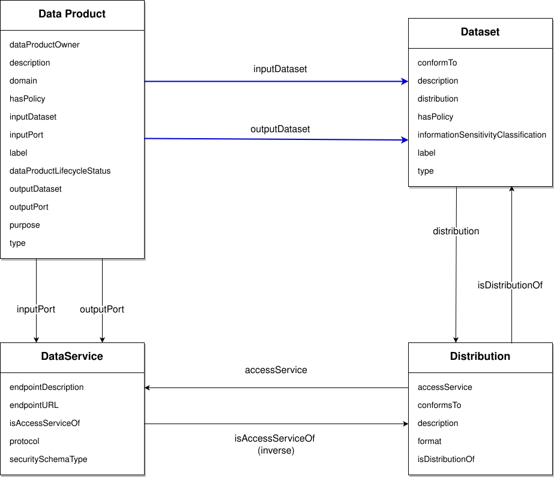

---
grapharch:
  subject: urn:dprod-showcase:overview:03-model
---

DPROD extends DCAT. Its model connects a managed data product to the services through which data is exchanged, and to the datasets and distributions those services expose.

## Read the model as four questions

1. **What is the product?** A Data Product describes a managed collection of data, with purpose, value, ownership, and a planned lifecycle.
2. **How can I exchange data?** Ports are DCAT Data Services. They describe input or output interfaces and their connection details.
3. **Which data does it represent?** A Dataset describes the logical collection. Its shared schema can be referenced with `conformsTo`.
4. **In which form can I obtain it?** A Distribution describes a representation and access arrangement, such as JSON, CSV, or Parquet.

A dataset can have multiple distributions. A product can have multiple ports. Keeping these concepts distinct lets the description explain both meaning and delivery without treating a file format as the product itself.
