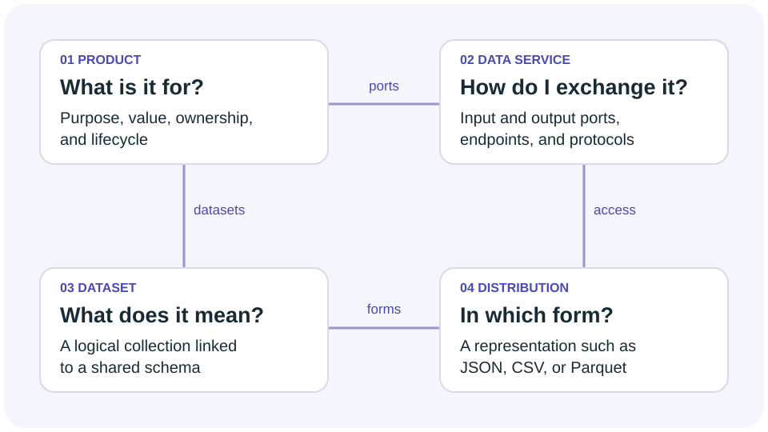

Model

# Core Concepts

The building blocks of every DPROD description. Each concept links to its normative definition in the specification.

## Data Product

A rational, managed, and governed collection of data with purpose, value, and ownership, meeting consumer needs over a planned lifecycle. Data products have input and output ports, code, and metadata.

[Normative definition in the spec](https://ekgf.org/dprod/spec/#dataproductshape)

## Ports (Data Services)

Digital interfaces that provide access to datasets. Input ports bring data into the product, while output ports share generated data. Ports specify connection details, formats, and link to datasets with shared schemas.

[Normative definition in the spec](https://ekgf.org/dprod/spec/#dataserviceshape)

## Distributions

Physical representations of data — CSV, JSON, Parquet, and access methods. A single dataset may have multiple distributions to serve different consumer needs without duplicating the underlying information.

[Normative definition in the spec](https://ekgf.org/dprod/spec/#distributionshape)

## Datasets

Logical models of the data that can conform to shared standards like FIBO, CDM, or custom ontologies using SHACL or OWL. The schema lives with the data, not in out-of-band documentation.

[Normative definition in the spec](https://ekgf.org/dprod/spec/#datasetshape)

## Use cases

Where DPROD delivers its value. Each use case is reinforced by the same small vocabulary — no per-project extensions required.

### Data Mesh Implementation

Enable domain-oriented decentralised data ownership with standardised product descriptions. Every domain publishes its data products in the same machine-readable format.

### Data Marketplaces

Build internal or external data marketplaces with discoverable, well-described data products. Replace bespoke metadata schemas with a single shared vocabulary.

### Multi-Cloud Integration

Integrate data products across different cloud platforms and vendors with vendor-neutral descriptions. Portability is designed in, not retrofitted.

### Data Governance & Compliance

Track lineage, enforce policies, and maintain quality metrics across all data products. DPROD integrates with ODRL, PROV, and DQV for end-to-end governance.
