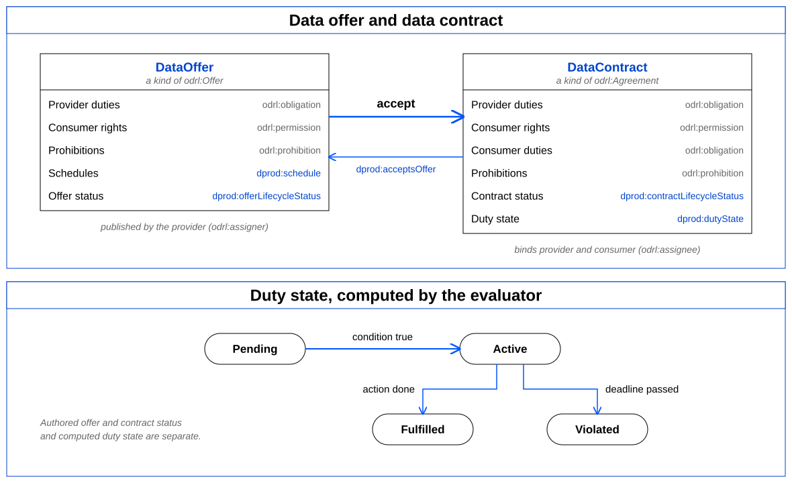

A provider publishes a [`dprod:DataOffer`](https://ekgf.org/dprod/spec/develop/DataOffer), an `odrl:Offer`
setting out the provider's duties, the consumer's rights and what is prohibited. When a consumer accepts
it, the result is a [`dprod:DataContract`](https://ekgf.org/dprod/spec/develop/DataContract), an
`odrl:Agreement` that binds both parties, may add duties on the consumer, and links back to
the offer it accepts. Each row of the figure names the property that carries it; DPROD terms are shown
in blue. The lower part shows the state an evaluator computes for each duty.



Overview of DPROD Data Contracts: offer, acceptance, contract and duty state

A data product, or any of its datasets, distributions and data services, is an `odrl:Asset`
when it appears as the `odrl:target` of a policy. Teams and organisations are
`odrl:Party` instances. Both may be grouped into ODRL collections using
`odrl:partOf`; DPROD evaluates membership over the transitive closure of that property, so a
rule on a collection applies to everything in it.

The lifecycle of an offer or a contract is recorded with
[`dprod:offerLifecycleStatus`](https://ekgf.org/dprod/spec/develop/offerLifecycleStatus) and
[`dprod:contractLifecycleStatus`](https://ekgf.org/dprod/spec/develop/contractLifecycleStatus). Both are
sub-properties of the core `dprod:lifecycleStatus` and take any `skos:Concept`;
DPROD ships `dprod:DataContractLifecycleStatus`, an optional concept scheme with the values
`dprod:Pending`, `dprod:Active`, `dprod:Fulfilled` and
`dprod:Violated`, which an enterprise may use, extend or replace.

A DPROD-aware evaluator answers the question "may this agent perform this action on this asset now?"
It never reads a live graph while doing so. Instead the caller assembles one immutable
[`dprod:EvaluationContext`](https://ekgf.org/dprod/spec/develop/EvaluationContext) holding the authorisation request,
a snapshot of the state of the world, the requesting agent and the clock. Each
`odrl:LeftOperand` used in a constraint declares which of those inputs it reads
(`dprod:operandSource`) and which single property it reads from it
(`dprod:operandProperty`). A value that is missing, ambiguous or of the wrong type is an
evaluation error rather than a silently false constraint. ODRL's own `odrl:dateTime` operand
is bound to the context clock, and `dprod:currentAgent` to the requesting agent.

In this example the Trading Data Team offers its Market Price Data product with a single provider duty
(deliver every 15 minutes, within 5 minutes of the scheduled time), one consumer permission and one
prohibition. The Analytics Team has accepted the offer for 2026; the contract names both parties and
links to the offer it accepts.

```
  {
    "@context": [
      "https://ekgf.org/dprod/spec/develop/dprod-simple.jsonld",
      { "ex": "https://example.org/" }
    ],
    "id": "ex:tradingMarketData2026",
    "type": "DataContract",
    "profile": "https://ekgf.org/dprod/spec/develop/",
    "assigner": "ex:tradingDataTeam",
    "assignee": "ex:analyticsTeam",
    "target": "ex:marketPrices",
    "contractLifecycleStatus": "Active",
    "effectiveDate": "2026-01-15T00:00:00Z",
    "expirationDate": "2026-12-31T23:59:59Z",
    "permission": {
      "type": "Permission",
      "assignee": "ex:analyticsTeam",
      "action": "display"
    },
    "acceptsOffer": {
      "id": "ex:marketDataFeed",
      "type": "DataOffer",
      "profile": "https://ekgf.org/dprod/spec/develop/",
      "assigner": "ex:tradingDataTeam",
      "target": "ex:marketPrices",
      "offerLifecycleStatus": "Active",
      "obligation": {
        "type": "Duty",
        "subjectOfDuty": "ex:tradingDataTeam",
        "action": "ex:deliver",
        "schedule": {
          "id": "ex:every15Minutes",
          "type": "Schedule",
          "conformsTo": "dprod:Rfc5545ScheduleFormat",
          "scheduleExpression": "DTSTART;TZID=Europe/London:20260101T000000\nRRULE:FREQ=MINUTELY;INTERVAL=15"
        },
        "deadline": { "@value": "PT5M", "type": "xsd:duration" }
      },
      "permission": { "type": "Permission", "action": "display" },
      "prohibition": { "type": "Prohibition", "action": "distribute" }
    }
  }
```

ODRL terms are written as plain names, in the same way DCAT terms are in a data product description.
The context knows that an action, an operator or a status names a vocabulary term, so
`"action": "display"` denotes `odrl:display` and
`"contractLifecycleStatus": "Active"` denotes `dprod:Active`. The offer is shown nested
inside the contract for readability. In practice a provider publishes the offer once, as its own
resource, and each contract that accepts it refers to it by identifier.
The full version of this example, with the domain vocabulary, the parties and the evaluated duty
instances, is in the [Data Offer and Contract](urn:dprod-showcase:example:contracts:data-offer-and-contract) worked example.

The following class definitions are driven by the contracts Shapes, in the same way as the core model
above. Only classes DPROD defines are listed here; the ODRL classes the profile reuses are defined by
[odrl-model](https://www.w3.org/TR/odrl-model/), and the DPROD properties that extend them follow in the next section.
