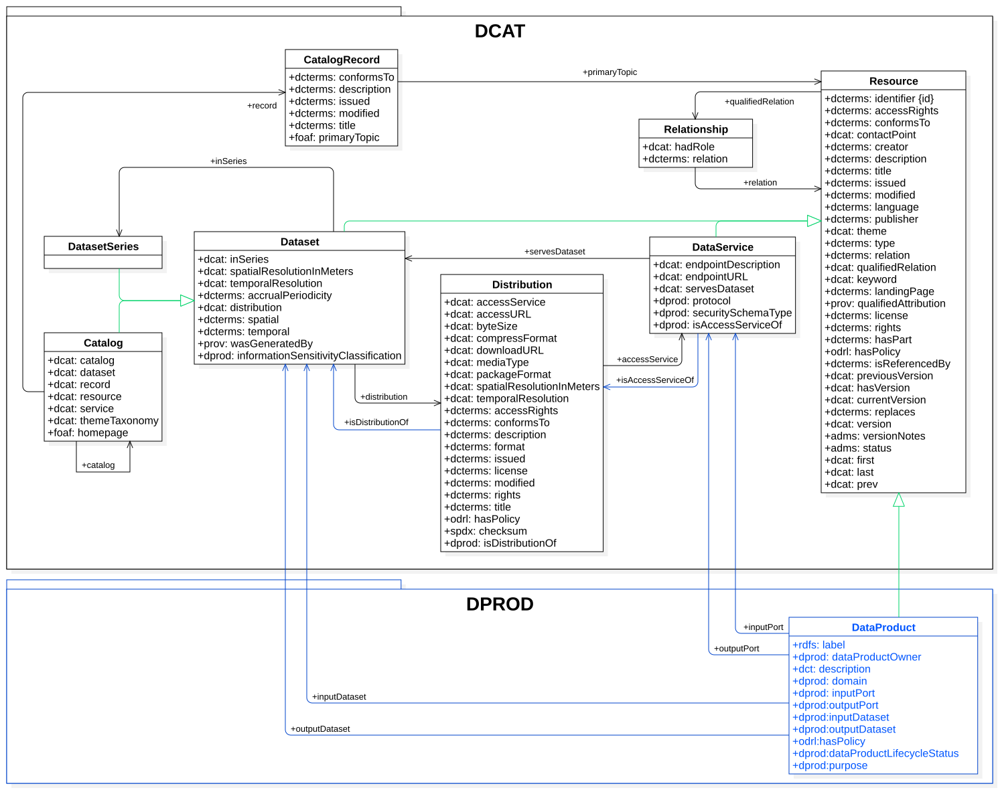

[Data Mesh Architectures](https://en.wikipedia.org/wiki/Data_mesh) [Data Mesh](https://en.wikipedia.org/wiki/Data_mesh) use input and output ports to manage
how data enters and leaves a Data Product. These ports can handle different formats, schemas, and protocols. Input
ports bring in data, while output ports send data to other Data Products for aggregation, reuse, analysis or
reporting, etc.

In the [vocab-dcat-3](https://www.w3.org/TR/vocab-dcat-3/) framework,
a [Data Service](https://www.w3.org/TR/vocab-dcat-3/#Class:DataService) is a way
to describe services that provide access to data.
Data Services give standardized, machine-readable descriptions of how to access one or more
datasets or data processing functions.

Data Services specify how to access and download the data. In DPROD, Data Services are connected to
[Distributions](https://www.w3.org/TR/vocab-dcat-3/#Class:Distribution) by a property called
[isAccessServiceOf](https://ekgf.org/dprod/spec/develop/isAccessServiceOf);
on the Distribution one can specify formats (like CSV or JSON etc.)
and provide metadata about the "physical model" of the data. Distributions link to
[Datasets](https://www.w3.org/TR/vocab-dcat-3/#Class:Dataset) and DCAT has a very rich vocabulary for
describing every aspect of a dataset. Finally, Datasets use the
[conformsTo](https://www.w3.org/TR/vocab-dcat-3/#Property:resource_conforms_to) property to link to the
"logical model" where one can specify one's own rich semantic metadata.

By linking Data Product ports to DCAT DataServices ([vocab-dcat-3](https://www.w3.org/TR/vocab-dcat-3/)),
DPROD can describe Data Products in a way that machines can read
across the organization. This makes it easier for data teams to build and manage their own data products
independently, while still working well with the rest of the organization's data.

Using standards like DCAT helps create a strong and clear way to define Data Products. It ensures that as data
becomes more complex, the methods for describing, sharing, and using data stay consistent and reliable. It also
allows different organizations to share data securely and in a standardized way.



Overview of the DPROD model and its relationship with DCAT classes

The Profile consists of the following classes:

- Data Mesh (`dcat:Catalog`) - The collection of Data Products
- Data Product (`dprod:DataProduct`) - A data product may have input and output ports, code and
  metadata
- Port (`dcat:DataService`) - A digital interface that provides access to a Dataset.
  This can be an HTTP URL, a Database or a FileShare, etc.
- Distribution (`dcat:Distribution`) - A specific representation of a dataset (CSV, JSON, ADLS etc.)
  which can conform to a physical model
- Dataset (`dcat:Dataset`) - A collection of related data that can conform to a logical model

As [DCAT Data Services](https://www.w3.org/TR/vocab-dcat-3/#Class:Data_Service),
the DPROD [input](https://ekgf.org/dprod/spec/develop/inputPort) and
[output](https://ekgf.org/dprod/spec/develop/outputPort) ports can specify connection details, they have [distributions](https://www.w3.org/TR/vocab-dcat-3/#Class:Distribution) that define formats, and link to [datasets](https://www.w3.org/TR/vocab-dcat-3/#Class:Dataset) that conform to shared schemas. In this
example,
the UK Bonds Data Product includes an output port, which is a RESTful API. This API delivers JSON data conforming to
the shared FIBO specification for callable bonds.

```
  {
    "@context": "https://ekgf.org/dprod/spec/develop/dprod-simple.jsonld",
    "id": "https://y.com/products/uk-bonds",
    "type": "DataProduct",
    "title": "UK Bonds",
    "description": "UK Bonds is your one-stop-shop for all your bonds!",
    "dataProductOwner": "https://www.linkedin.com/in/tonyseale/",
    "dataProductLifecycleStatus": "https://ekgf.org/dprod/spec/develop/data/lifecycle-status/Consume",
    "outputPort": {
      "id": "https://y.com/products/uk-bonds/ports/10-year-api",
      "type": "DataService",
      "endpointURL": "https://y.com/uk-10-year-bonds",
      "isAccessServiceOf": {
        "id": "https://y.com/products/uk-bonds/distributions/10-year-json",
        "type": "Distribution",
        "format": "https://www.iana.org/assignments/media-types/application/json",
        "isDistributionOf": {
          "id": "https://y.com/products/uk-bonds/datasets/10-year",
          "type": "Dataset",
          "conformsTo": "https://spec.edmcouncil.org/fibo/ontology/SEC/Debt/Bonds/CallableBond"
        }
      }
    }
  }
```

DPROD publishes two JSON-LD contexts that denote the same graph. The examples in this specification
use the simple context, `dprod-simple.jsonld`, which lets a document use plain terms such
as `outputPort`, `title`, `id` and `type`. When DPROD
JSON is combined with other JSON-LD contexts, use `dprod-context.jsonld` and prefixed
terms such as `dprod:outputPort` and `dct:title` with the keywords
`@id` and `@type`, so that neither side claims generic names such as
`title` or `format`. Neither context has an `@vocab`, so an
undefined term is visibly undefined rather than silently coined in the DPROD namespace.
  
The JSON above can be pasted into [https://json-ld.org/playground](https://json-ld.org/playground/)
to see the RDF it denotes.

The following sections are driven by the Shapes definitions for DPROD, which represent the properties
expected to be used for instances of the above classes.
As such, they include properties defined by the DCAT specification which DPROD extends.
The prefix in the *identifier* for each entry indicates the ontology defining the property.
